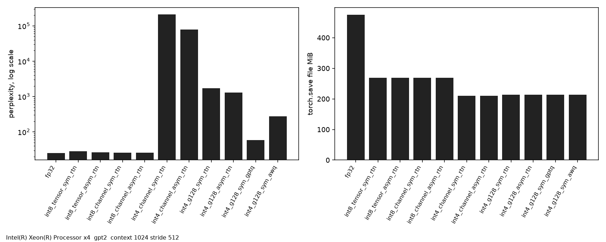

# ptqkit

Post-training quantization of `nn.Linear` and GPT-2 `Conv1D` weights to int8 or int4. Activations stay fp32. A CPU kernel multiplies fp32 activations by dequantized int8 or int4 weights.

## Grid

Codes are integers `q` in `[0, qmax]`, `qmax = 2^b - 1`. `torch.round` is round-half-to-even.

```
W_hat[m, k] = scale[m, g] * (q[m, k] - zero[m, g]) * channel_scale[k]
g = k // group_size
```

`channel_scale` is omitted when it is identically 1.

Symmetric:

```
amax = max(abs(W))          over the reduction axes
scale = 2 * amax / qmax     scale = 1 if amax = 0
zero = (qmax + 1) / 2       128 for int8, 8 for int4
q = clip(round(W / scale) + zero, 0, qmax)
```

Asymmetric. The range is expanded so it contains 0. A block that is all zeros uses `xmin, xmax = -1, 1`.

```
xmin = min(min(W), 0)
xmax = max(max(W), 0)
scale = (xmax - xmin) / qmax
zero = clip(round(-xmin / scale), 0, qmax)
q = clip(round(W / scale) + zero, 0, qmax)
```

Reduction along the input axis `K` of a weight stored as `[out, K]`:

| `group_size` | scales | meaning |
| --- | --- | --- |
| `0` | `[1, 1]` | one scale for the matrix |
| `None` | `[out, 1]` | one scale per output row |
| `G > 0` | `[out, ceil(K / G)]` | contiguous groups along `K`. The last group is short when `K` is not a multiple of `G` |

Per-tensor and per-channel storage set the kernel `group_size` to `K`, so `g = 0` everywhere.

## int4 packing

```
packed[m, j] = (q[m, 2j] & 15) | ((q[m, 2j + 1] & 15) << 4)
```

Low nibble is the even column. High nibble is the next column. Odd `K` is padded with a zero code. The pad is not part of the dot product. int8 codes are stored as uint8 `[out, K]` and are not packed.

## RTN

Round-to-nearest on the grid above. Group scales are independent.

For entries of the block that defined the scale, fp32 rounding aside:

```
symmetric:   |W - W_hat| <= scale / 2
asymmetric:  |W - W_hat| <= scale
```

The symmetric positive endpoint lands half a bin below `amax`, because `zero = (qmax + 1) / 2` makes the grid one code longer on the negative side. The asymmetric zero is rounded, so the bound is one bin rather than half a bin. Tests check these inequalities with an extra `1e-4` absolute tolerance.

## GPTQ

For one layer and calibration rows `X` of shape `[n, K]`:

```
min_q || X W^T - X W_hat(q)^T ||_F^2
H = X^T X / n
```

`H` is symmetrized. A zero diagonal (an input channel with no calibration energy) is isolated: that row and column of `H` are cleared, the diagonal is set to 1, and the weight column is set to 0. Damping:

```
H_ii += percdamp * mean(diag(H))     default percdamp = 0.01
```

`Hinv` is the upper Cholesky factor of `H^{-1}`:

```
Hinv = chol(chol_inv(chol(H)), upper=True)
```

Columns are quantized left to right on the same grid as RTN. After column `i` is replaced by its grid point:

```
err = (w_i - w_hat_i) / max(Hinv[i, i], 1e-8)
W[:, i:] -= err * Hinv[i, i:]
```

The `1e-8` floor is only there to stop a zero pivot. Group scales are taken from the updated float weights at the first column of the group. Per-channel and per-tensor scales are computed once, before the sweep, then held fixed. Column blocking for those fixed grids uses `blocksize` (default 128).

Two calibration orders:

* `sequential`: modules are quantized in `named_modules` order. After each module is replaced, calibration is run again, so later Hessians see earlier quantized layers. Those forwards use a cached fp32 reconstruction of the integer weights.
* `fp32`: one pass over the unquantized model. Every Hessian is built from those inputs.

## AWQ

```
m_k = mean_i |X_ik|
s(alpha)_k = m_k^alpha / mean(m^alpha)
W_hat = dequant(RTN(W diag(s))) diag(s)^{-1}
```

`alpha` is chosen from `(0, 0.25, 0.5, 0.75, 1)` to minimize `||X_s W^T - X_s W_hat^T||_F^2`. `X_s` is at most the first 2048 captured rows. `m_k` uses every captured row. `alpha = 0` is `s = 1`, so the search loss is at most the RTN loss on `X_s`. The stored `channel_scale` is `1/s`. A global positive rescaling of `s` cancels between the RTN range and this multiplier.

## Kernel

`y[b, m] = sum_k W_hat[m, k] * x[b, k]`.

OpenMP splits output rows. Each worker dequantizes one row into a private fp32 buffer, then dots it with every batch row. AVX2, when the build machine has the flag, converts 8 int8 codes or 16 int4 nibbles per iteration and accumulates with FMA. int4 bytes are split with a 4-bit shift and `unpacklo_epi8` so the low nibble stays the even column. Tails and odd group starts are scalar. The extension releases the GIL for the parallel region. `nthreads <= 0` uses the OpenMP default.

Build flags: `-O3 -fopenmp`, plus `-mavx2 -mfma` when `/proc/cpuinfo` contains `avx2`.

## Build

C++17 compiler and OpenMP (`g++`, `libgomp`). Python >= 3.10.

```
python -m pip install -e ".[dev,eval]"
ruff check src tests
ruff format --check src tests
mypy src
pytest -q
```

Measurement run (downloads GPT-2 and WikiText-2 into the Hugging Face cache, not into this repo):

```
python -m ptqkit --model gpt2 --output results/gpt2_wikitext2.json
```

Defaults: context 1024, stride 512, 64 calibration sequences of length 128, batch 8, sequential activation order. `--activation-order fp32` uses one calibration pass. `--max-windows N` truncates perplexity; the published run does not set it.

Perplexity is `exp(sum nll_i / N)`. The model drops `labels[:, 0]`. `N` is the number of remaining labels that are not `-100`. With stride < context, token indices `1 .. T-1` are each scored once. With stride = context, the first token of each chunk is not scored.

## Usage

```python
import torch
from transformers import AutoModelForCausalLM, AutoTokenizer
from ptqkit import Method, QuantConfig, quantize_model

model = AutoModelForCausalLM.from_pretrained("gpt2").eval()
cfg = QuantConfig(bits=4, symmetric=True, group_size=128, method=Method.RTN)
quantize_model(model, cfg)
ids = AutoTokenizer.from_pretrained("gpt2")("weights", return_tensors="pt").input_ids
logits = model(ids).logits

# GPTQ needs calibration batches of the same tensors the model forward accepts.
gptq = QuantConfig(bits=4, symmetric=True, group_size=128, method=Method.GPTQ)
quantize_model(model, gptq, [ids], sequential=True)
```

`Conv1D` weights are `[in, out]` in the module and `[out, in]` after quantization. `QuantizedLinear.impl = "kernel"` selects the C++ GEMM. `materialize()` caches the fp32 reconstruction; perplexity uses that cache. Embeddings, layer norms, and biases stay fp32. `lm_head` is quantized, which breaks the GPT-2 weight tie with the token embedding. `save_compressed` writes uint8 codes, fp16 scales and zeros (integers in `[0, 255]` are exact in fp16), fp16 channel scales, fp32 biases, and the untouched parameters.

## Layout

```
src/ptqkit/quant.py    grid, RTN, dequant
src/ptqkit/pack.py     int4 nibbles
src/ptqkit/gptq.py     column OBS
src/ptqkit/awq.py      activation scales
src/ptqkit/convert.py  module swap, compressed state
src/ptqkit/gemm.py     reference and kernel entry
src/ptqkit/csrc/dequant_gemm.cpp
src/ptqkit/measure.py  perplexity, size, timing
```

## Measurements

CPU: Intel(R) Xeon(R) Processor family 6 model 207 stepping 2, 4 threads, ISA ['avx2', 'fma', 'avx512f'].
MemTotal 16387280 KiB, MemAvailable 4919608 KiB at measurement start.
Python 3.12.3, torch 2.14.1+cpu, BLAS `- Intel(R) MKL-DNN v3.12.0 (Git Hash 80afa71049cd69a3df32adcccb623b12cd7baa22)`.
Kernel build: {'avx2': True, 'openmp': True}.
Protocol: model `gpt2`, Salesforce/wikitext wikitext-2-raw-v1 test, context 1024, stride 512, calibration 64 x 128 from train, activation order `sequential`.
Scored tokens: 287643. Windows: 561.

| method | bits | sym | group | ppl | payload bytes | file bytes | matrix bytes |
| --- | --- | --- | --- | --- | --- | --- | --- |
| fp32 | 32 |  |  | 25.1703 | 652148736 | 497813567 | 494128128 |
| int8_tensor_sym_rtn | 8 | true | 0 | 28.5929 | 281552836 | 281634181 | 123532228 |
| int8_tensor_asym_rtn | 8 | false | 0 | 26.7147 | 281552836 | 281634181 | 123532228 |
| int8_channel_sym_rtn | 8 | true |  | 25.8959 | 282085444 | 282167109 | 124064836 |
| int8_channel_asym_rtn | 8 | false |  | 26.0747 | 282085444 | 282167109 | 124064836 |
| int4_channel_sym_rtn | 4 | true |  | 208451.4237 | 220319428 | 220401093 | 62298820 |
| int4_channel_asym_rtn | 4 | false |  | 78216.9786 | 220319428 | 220401093 | 62298820 |
| int4_g128_sym_rtn | 4 | true | 128 | 1702.0357 | 223647000 | 223728645 | 65626392 |
| int4_g128_asym_rtn | 4 | false | 128 | 1309.4966 | 223647000 | 223728645 | 65626392 |
| int4_g128_sym_gptq | 4 | true | 128 | 58.7966 | 223647000 | 223728645 | 65626392 |
| int4_g128_sym_awq | 4 | true | 128 | 274.5014 | 223777560 | 223875175 | 65756952 |

Matmul median latency. GFLOP/s = 2*B*M*K / time, dequant not counted.

| layer | M | K | B | kind | median ms | GFLOP/s |
| --- | --- | --- | --- | --- | --- | --- |
| attn_qkv | 2304 | 768 | 1 | fp32 | 0.0333 | 106.13 |
| attn_qkv | 2304 | 768 | 1 | int8 | 0.0950 | 37.27 |
| attn_qkv | 2304 | 768 | 1 | int4 | 0.1006 | 35.19 |
| attn_qkv | 2304 | 768 | 16 | fp32 | 0.1286 | 440.30 |
| attn_qkv | 2304 | 768 | 16 | int8 | 0.3096 | 182.90 |
| attn_qkv | 2304 | 768 | 16 | int4 | 0.2798 | 202.38 |
| attn_qkv | 2304 | 768 | 128 | fp32 | 0.5476 | 827.19 |
| attn_qkv | 2304 | 768 | 128 | int8 | 2.1602 | 209.69 |
| attn_qkv | 2304 | 768 | 128 | int4 | 1.8995 | 238.47 |
| attn_out | 768 | 768 | 1 | fp32 | 0.0117 | 100.95 |
| attn_out | 768 | 768 | 1 | int8 | 0.0400 | 29.51 |
| attn_out | 768 | 768 | 1 | int4 | 0.0417 | 28.26 |
| attn_out | 768 | 768 | 16 | fp32 | 0.0505 | 374.01 |
| attn_out | 768 | 768 | 16 | int8 | 0.1009 | 187.02 |
| attn_out | 768 | 768 | 16 | int4 | 0.1011 | 186.65 |
| attn_out | 768 | 768 | 128 | fp32 | 0.1965 | 768.54 |
| attn_out | 768 | 768 | 128 | int8 | 0.6397 | 236.03 |
| attn_out | 768 | 768 | 128 | int4 | 0.6427 | 234.95 |
| mlp_up | 3072 | 768 | 1 | fp32 | 0.0522 | 90.47 |
| mlp_up | 3072 | 768 | 1 | int8 | 0.1811 | 26.05 |
| mlp_up | 3072 | 768 | 1 | int4 | 0.1809 | 26.08 |
| mlp_up | 3072 | 768 | 16 | fp32 | 0.1895 | 398.39 |
| mlp_up | 3072 | 768 | 16 | int8 | 0.3651 | 206.76 |
| mlp_up | 3072 | 768 | 16 | int4 | 0.3706 | 203.71 |
| mlp_up | 3072 | 768 | 128 | fp32 | 0.7374 | 819.05 |
| mlp_up | 3072 | 768 | 128 | int8 | 2.6210 | 230.44 |
| mlp_up | 3072 | 768 | 128 | int4 | 2.6764 | 225.67 |
| mlp_down | 768 | 3072 | 1 | fp32 | 0.0524 | 90.04 |
| mlp_down | 768 | 3072 | 1 | int8 | 0.1316 | 35.87 |
| mlp_down | 768 | 3072 | 1 | int4 | 0.1338 | 35.27 |
| mlp_down | 768 | 3072 | 16 | fp32 | 0.3853 | 195.95 |
| mlp_down | 768 | 3072 | 16 | int8 | 0.3858 | 195.69 |
| mlp_down | 768 | 3072 | 16 | int4 | 0.3872 | 195.01 |
| mlp_down | 768 | 3072 | 128 | fp32 | 0.8224 | 734.37 |
| mlp_down | 768 | 3072 | 128 | int8 | 3.1428 | 192.18 |
| mlp_down | 768 | 3072 | 128 | int4 | 3.1368 | 192.55 |

| model | seq | impl | median ms |
| --- | --- | --- | --- |
| int8_channel_sym_rtn | 1 | kernel | 10.5362 |
| int8_channel_sym_rtn | 128 | kernel | 165.7352 |
| int4_g128_sym_rtn | 1 | kernel | 10.5311 |
| int4_g128_sym_rtn | 128 | kernel | 163.2076 |
| fp32 | 1 | fp32 | 13.6840 |
| fp32 | 128 | fp32 | 65.8341 |

Max abs logit gap, kernel vs reference dequant, shape [1, 8]:
- int8_channel_sym_rtn: 4.577637e-05
- int4_g128_sym_rtn: 7.247925e-05

Kernel compiled with g++ 13.3.0, flags `-O3 -fopenmp -mavx2 -mfma`.

Perplexity uses a cached fp32 reconstruction of the quantized weights. `payload bytes` sums tensor nbytes. `file bytes` is the `torch.save` size. The fp32 file is smaller than its payload because the archive compresses fp32 tensors. `matrix bytes` counts codes plus fp16 scales, zeros, and channel scales, and leaves out embeddings, norms, and biases.

Mean selected AWQ alpha across quantized modules: 0.244898.



A model near 1B parameters was not measured. MemAvailable at the start of this run was 4919608 KiB.


## License

MIT. See `LICENSE`.
